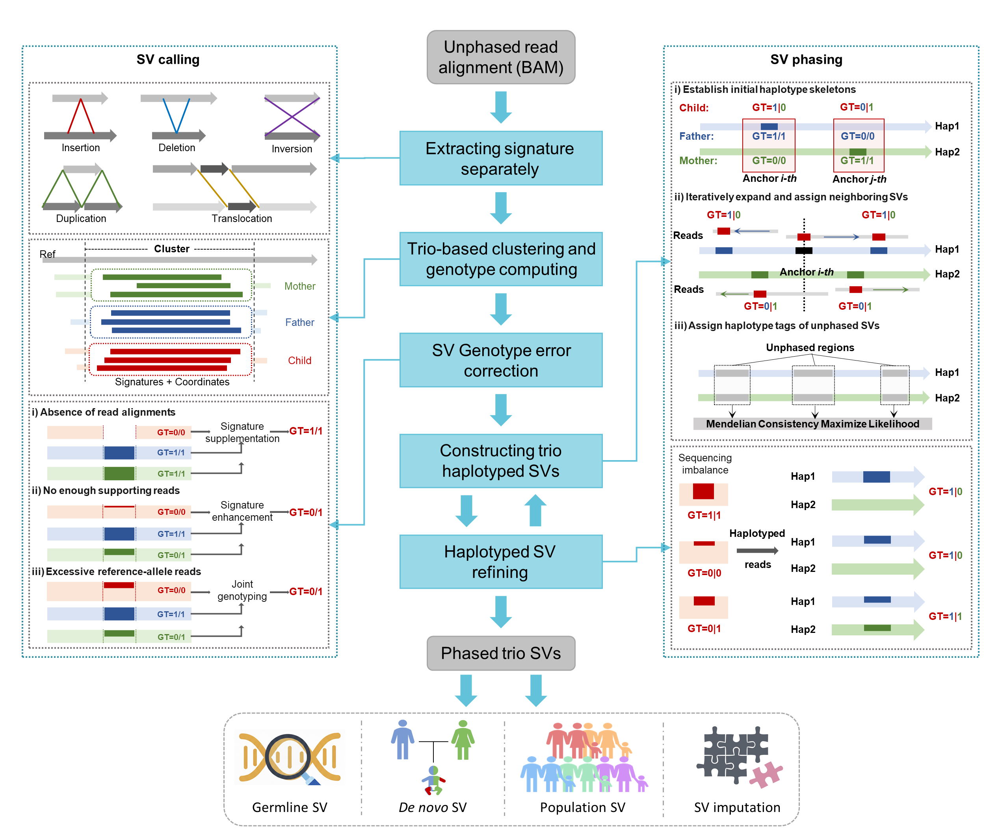

# cuteSV-Trio: Haplotype-Resolved and *De Novo* Structural Variant Detection from Low-Coverage Long-Read Sequencing of Family Trios


[](https://pypi.org/project/cuteSVTrio/1.1.1/)
[](https://anaconda.org/bioconda/svpg)
[](https://anaconda.org/bioconda/svpg)

<div align="center">
  <a target="_blank">
    
  </a>
</div>

------


## Contents


- [Introduction](#Introduction)
- [Workflow](#Workflow)
- [Installation](#Installation)
- [Dependence](#Dependence)
- [Usage](#Usage)
- [QuickDemo](#QuickDemo)
- [PopulationSVs callset constructing](#Population-SVs-callset-constructing)
- [Reference panel bulding and benchmarking](#Reference-panel-bulding-and-benchmarking)
- [LatestUpdates](#LatestUpdates)
- [Contact](#Contact)


------


## Introduction

Long-read sequencing technologies have advanced structural variant (SV) detection into an era of full-spectrum characterization. While family trio-based high-coverage sequencing enhances SV detection resolution, its prohibitive cost and limited exploitation of intrinsic genetic properties pose significant barriers to widespread adoption. To address this challenge, we introduce cuteSV-Trio, a haplotype-resolved and de novo SV caller designed for low-coverage long-read trio sequencing data. cuteSV-Trio leverages Mendelian inheritance patterns and haplotype linkage information through novel family-wide clustering strategies to achieve high-precision haplotype-resolved SV detection and robust de novo SV identification. Benchmarking across orthogonal datasets demonstrates that cuteSV-Trio outperforms existing SV calling methods by 0.47%-22.48% in Genotype-F1 score. Moreover, cuteSV-Trio reduces haplotype-phasing error rates by ~16% and detects ~36% more precise de novo SVs. In addition, it is well-suited for constructing comprehensive population SV atlases and high-quality reference panels, improving imputation accuracy. By dramatically reducing sequencing costs while improving detection accuracy, cuteSV-Trio provides a practical framework for trio-based and population-scale SV studies.


------


## Workflow
cuteSV-Trio utilizes low-coverage long-read alignments from three family members (i.e., two parents and their offspring) to detect haplotype-resolved SVs within the trio. The method consists of five major steps designed to achieve high-performance SV detection

<div align="center">
  <a target="_blank">
    
  </a>
</div>

**Step 1**: Extract SV signatures and their corresponding long-read alignment coordinates separately for each family member. Then, integrate these individual results into a unified, family-specific SV signature set.

**Step 2**: Apply the stepwise refinement clustering strategy proposed by cuteSV to group SV signatures based on their genomic coordinates and variant sizes. Next, separate alternative-allele-supporting reads and reference-allele-supporting reads according to the individual labels within each cluster. Then, use a Maximum Likelihood Estimation (MLE) model to compute preliminary genotypes for each SV in each individual.

**Step 3**: Assess the genotype of each SV locus at the family level using Mendelian inheritance patterns and identify inconsistencies for correction. By correction in three main scenarios, cuteSV-Trio utilizes the corresponding family-level cluster to calculate trio-based joint genotypes, which are then used to assist in correcting the family members’ genotype.

**Step 4**: Leverage Mendelian inheritance patterns and long-read linkage information to construct haplotype-resolved SV callsets. CuteSV integrates the inheritance information and sequence linkage information of SV, correctly and conveniently assign each SV to the haplotype that maximizes Mendelian consistency. 

**Step 5**: Afterwards, refine the SV genotypes of all members on the binary read sets after haplotype resolution. To address SV genotype errors caused by three types of sequencing reads imbalances, cuteSV-Trio refines SVs based on the distribution of haplotyped reads.


------


## Installation

### Option 1. Install by src

```
git clone https://github.com/XLeeHIT/cuteSV-Trio && cd cuteSV-Trio/ && python -m pip install .
```

### Option 2. Install by BioConda

```
conda install cuteSVTrio 
```

### Option 3. Install by PyPi

```
pip install cuteSVTrio
```


------


## Dependence

```
1. python3
2. scipy
2. pysam
3. Biopython
4. numpy
5. pyvcf3
6. scikit-learn
```

------


## Usage

```
cuteSVTrio <reference.fa> <offspring.sorted.bam> <father.sorted.bam> <mother.sorted.bam> <output.vcf> <work_dir>
```


------


| Key  Parameter        | Required | Description                                                  | Default        |
| --------------------- | -------- | ------------------------------------------------------------ | -------------- |
| --reference           | ✅        | The reference  genome in fasta format                        | *(no default)* |
| --input_offspring     | ✅        | Sorted  .bam file of offspring in family from NGMLR or Minimap2. | *(no default)* |
| --input_parent_1      | ✅        | Sorted  .bam file of father or only parent in family from NGMLR or Minimap2. | *(no default)* |
| --input_parent_2      | ✅        | Sorted  .bam file of mother in family from NGMLR or Minimap2. | *(no default)* |
| --output              | ✅        | Output  VCF format file.                                     | *(no default)* |
| --work_dir            | ✅        | Work-directory  for distributed jobs                         | *(no default)* |
| --min_support_list    | ✅        | Minimum  number of reads of each member of family that support a SV to be reported. It  is recommended to divide the data coverage by 6. | *(no default)* |
| --execute_stage       | ❌        | The  stage of this operation execution. 1:Run all member signature extraction  2:Run family signature clustering and variant generation 0:Execute both two  stage 1 and 2 | 0              |
| --performing_phasing  | ❌        | The  option of performing structural variant phasing.        | FALSE          |
| --family_mode         | ❌        | Mode  of members in family. M1:Family of offspring, father and mother M2:Family of  offspring and father/mother | M1             |
| --sequencing_platform | ❌        | The  option of sequencing platform affects a series of parameters in the signature  clustering. | NULL           |
| --threads             | ❌        | Number  of threads to use.                                   | 16             |

Other parameters can be found by **-h/--help**.


------


## QuickDemo

```
demo/fam.1.bam-------------------------The 30X bam of offspring
demo/fam.2.bam-------------------------The 30X bam of father
demo/fam.3.bam-------------------------The 30X bam of mother

rm -r work/ ; 
mkdir work/ ; 
cuteSVTrio --retain_work_dir --write_old_sigs --performing_phasing -p HiFI -r demo/ref.fasta -o demo.vcf -w work/ --family_mode M1 --input_offspring demo/fam.1.bam --input_parent_1 demo/fam.2.bam --input_parent_2 demo/fam.3.bam --threads 32 --min_support_list 5,5,5 ; 
```


------


## Output

The output from cuteSV-Trio includes the following unique flag in vcf, with meanings as described below:

**CorrectType**:

A flag indicating that a SV's genotype has been corrected using the trio-based genotype correction method specific to cuteSV-Trio.

1–3: Genotype imputation for the offspring, father, and mother, respectively, performed via the "Absence of read alignments" method.

4–6: Genotype imputation for the offspring, father, and mother, respectively, performed via the "No enough supporting reads" method.

7–9: Genotype imputation for the offspring, father, and mother, respectively, performed via the "Excessive reference-allele reads" method.


------


## Population SVs callset constructing & Reference panel bulding and benchmarking

**Trio-based SV atlas built using cutesv-Trio can be accessed from [cuteMap](https://github.com/XLeeHIT/cuteMap).**


------


## LatestUpdates

v0.2.0 (June 10, 2025) : 

1. Add *CorrectType* tags to the SV supplemented by the three trio-based trio SV correction moethods and display them in the output VCF file. 
2. Add *parents_phasing* parameters to control whether the father and mother phase SV. By default, parents do not perform phasing, which can significantly reduce the spatiotemporal cost of phasing.

v0.3.0 (July 15, 2025) : 

1. Added processing to address some mosaic variations.
2. Addressing the issue of POS abnormalities in special chromosomes of hg38.

v0.4.0 (November 9, 2025) : 
1. Add a method to correct gt based on the read distribution of SV on the two haps after phasing.
2. Add an optional local assembly module to correct potential errors across the whole genome.

v0.5.0 (December 10, 2025) : 
1. In the local assembly module, a function has been added to supplement child sequences from parent sequencing data based on sequence similarity.
2. Add an algorithm to correct genotypes based on Mendelian disorder in non-newborn svs.

v1.0.0 (April 16, 2026) : 
1. The official version accompanying the formal paper submission.

v1.1.0 (September 18, 2026) :
1. Change the chromosome order to the more common 1-22-X-Y-other chromosome order.
2. Fixed several bugs related to the phasing functionality.
3. Fixed a bug causing missing information in the INFO field for INV records.
4. Revised the display logic of *CorrectType* to facilitate the identification of the three Mendelian correction outcomes.
5. Added an optional parameter to control the output of MAPQ values for SV-supporting reads.
6. The local assembly-based SV optimization implemented by cuteSVTrio_assembly.py is not a core components of cuteSV-Trio but rather an optional component. To ensure a smooth and convenient installation and usage, the cuteSVTrio_assembly.py code is not included in the standard installation. To use this component, you must choose the *Install by src* method: after downloading the code, replace *src/cuteSVTrio/cuteSVTrio_assembly.py* with *src/assembly/cuteSVTrio_assembly.py* and then re-run *python -m pip install .*. Otherwise, using assembly-related parameters will result in runtime errors.

v1.1.1 (September 19, 2026) :
1. Fix bugs in the post-processing step.

*Upcoming update*
1. The *-g* parameter was added to support the transition of the HG002 gold-standard benchmark from NIST to T2T around 2025. As the NIST benchmark is now largely deprecated, this parameter will be removed in a future release.
2. Added comprehensive null/empty-value checks and error handling for required parameters.
3. Further optimize the time and space overhead of calling and phasing.


------


## Contact

For advising, bug reporting and requiring help, please post on [Github Issue](https://github.com/XLeeHIT/cuteSV-Trio) or contact xinli01@stu.hit.edu.cn.